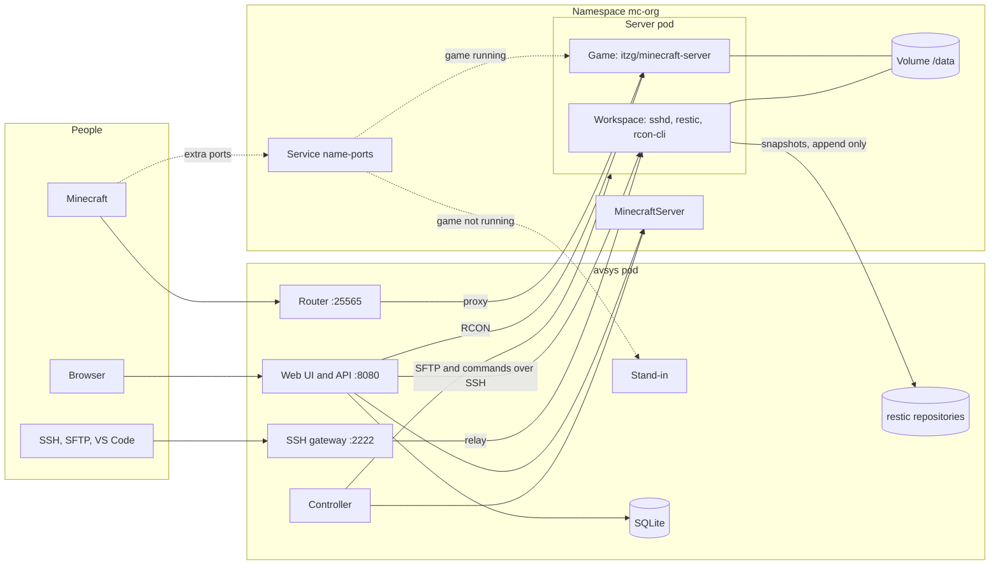
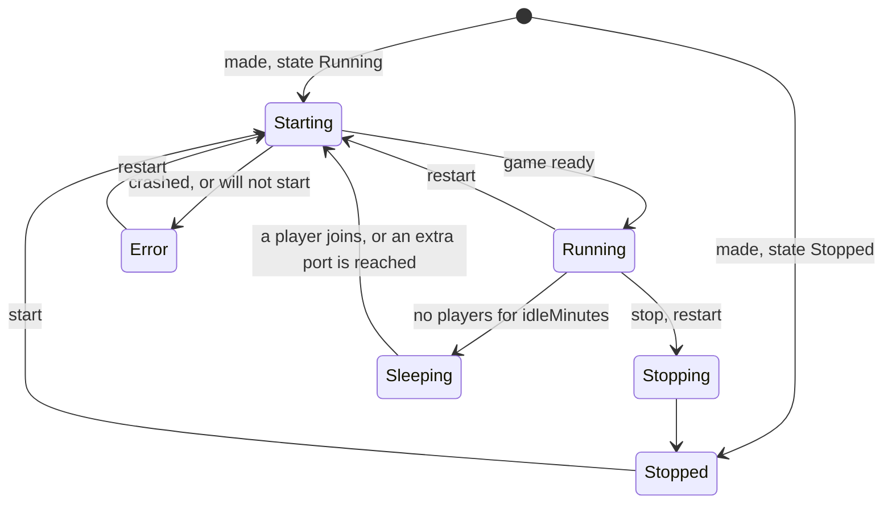
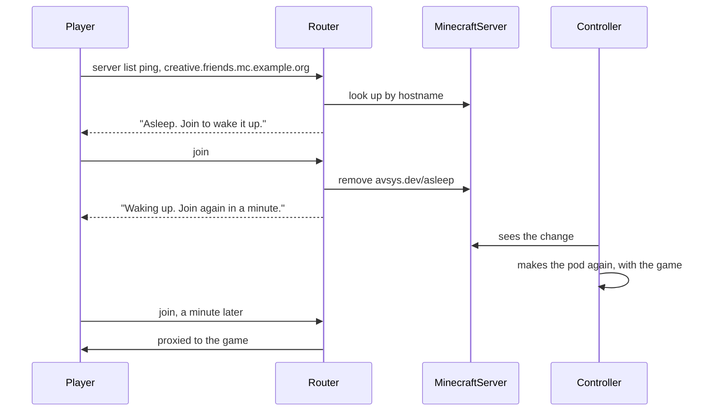

# Architecture

How avSYS is put together: the parts, what a server is made of, how one
lives and sleeps, how content and snapshots work, and how the panel keeps
people to what they may do.

## The parts

One binary, `avsys`, runs in one pod and does five jobs:

| Part | Port | Code | What it does |
| --- | --- | --- | --- |
| Controller | – | `internal/controller` | Turns each `MinecraftServer` resource into a pod, a volume, services and secrets, and keeps its status. Also watches players and puts idle servers to sleep. |
| Web UI and API | 8080 | `internal/api`, `web` | The panel, and the REST API under `/api/v1` that it is built on. Serves uploaded resource packs at `/packs/`. |
| SSH gateway | 2222 | `internal/sshgw` | Checks people's SSH keys and relays them to a server's workspace. |
| Router | 25565 | `internal/router` | Sends players to the server their address names. Answers for sleeping and stopped servers, and wakes them. |
| Stand-in | any | `internal/router/standin.go` | Answers on a server's extra ports while its game is not running, and wakes it. |

The panel also keeps, on its own volumes:

- a SQLite database (`internal/store`) for people: accounts, sessions,
  organizations and roles, invites, API tokens, SSH keys, linked Minecraft
  accounts, saved player lists, templates and the world library's records,
  notes on servers, names and colours of snapshots (by snapshot ID), and
  the panel's settings, including its two SSH keys. Notes and names are
  the panel's alone: never in a `MinecraftServer`, its files or the game;
- one [restic](https://restic.net) repository per organization
  (`internal/backup`) for snapshots;
- the game's command tree of each game version its servers run, in
  `commands/`, for the console to complete commands from.

Servers themselves live in Kubernetes. An organization `friends` gets the
namespace `mc-friends`, and each of its servers is a `MinecraftServer`
(short name `mcs`) there.



The panel is the only thing that reaches into the cluster. It runs as one
replica, replaced with `Recreate`, because the database is a single file on
a ReadWriteOnce volume. Game servers keep running while the panel is away;
connections through the router and the SSH gateway drop for that moment.

## The `MinecraftServer` resource

`api/v1alpha1` defines it. The `spec` is the same in the API as in the
cluster, so servers can be managed with `kubectl` or a GitOps tool as well
as with the panel; the API reference lists
[every field](api.md#the-server-resource). The panel installs and upgrades
the CRD itself each time it starts.

```console
$ kubectl get mcs -A
NAMESPACE       NAME       PHASE     VERSION   LOADER   PLAYERS   ADDRESS
mc-friends      creative   Running   1.21.4    paper    3         creative.friends.mc.example.org
mc-gt-drehmal   drehmal    Sleeping  1.20.1    fabric             mc.example.com
```

Work the panel has in hand on a server is kept as annotations on it
(`avsys.dev/asleep`, `avsys.dev/restoring`, `avsys.dev/importing`,
`avsys.dev/moving`, `avsys.dev/node`, and others), so a restart of the
panel picks it up where it was.

## What a server is made of

For a server `creative`, the controller makes, in its organization's
namespace, each owned by the `MinecraftServer` so that deleting it removes
them:

| Object | What it is |
| --- | --- |
| Pod `creative` | The game and the workspace, side by side. A bare pod: the controller decides when it is made again. |
| PersistentVolumeClaim `creative-data` | The server's files, mounted at `/data` in both containers. 10Gi unless set. It can grow, not shrink. |
| Service `creative` | Port 25565. `ClusterIP` for servers behind the router; `LoadBalancer` or `NodePort` for servers with an address of their own. |
| Service `creative-ports` | The extra ports of a server behind the router. See [Extra ports](#extra-ports-and-the-stand-in). |
| Secret `creative-rcon` | The RCON password. |
| Secret `avsys-workspace` | One per namespace: the key the gateway uses to reach workspaces. |
| Secret `avsys-curseforge` | One per namespace, where a server installs from CurseForge: the API key, read by the game as `CF_API_KEY`. |

The pod has two containers and no init containers:

- **`minecraft`**: [itzg/minecraft-server](https://github.com/itzg/docker-minecraft-server),
  tagged by the Java the server needs (`java8`, `java17`, `java21`,
  `java25`), unless `spec.image` names another. Its memory request and limit
  are both `spec.resources.memory`; the game's heap is sized under it. The
  controller gives it its settings as the image's environment variables:
  `TYPE`, `VERSION` and the loader build; `MODRINTH_PROJECTS`,
  `CURSEFORGE_FILES`, `MODS`, `PLUGINS` and `DATAPACKS` for content;
  `MODPACK_PLATFORM` and its fellows for a modpack; `RESOURCE_PACK` and
  `RESOURCE_PACK_SHA1`; `CUSTOM_SERVER_PROPERTIES`; `OPS` and `WHITELIST`;
  and `spec.env` last.
- **`workspace`**: the image `avsys-workspace` of the panel's own version,
  with sshd, restic and rcon-cli, running as the same user as the game. It
  is what SSH, the web terminal, the file browser and snapshots reach. It
  stays while the game is stopped or asleep, so a server that will not
  start can still be fixed.

Both share `/data` and a small in-memory volume holding the console's
input pipe, which is how a command typed "as the server" reaches the game.

### The console's commands

The console completes commands from the game's own command tree: every
command, subcommand and argument, as the game's parser has them. The game
writes it out as `reports/commands.json` when its data generator is run
with `--reports`, so the panel does that once for each game version, the
first time someone at a console of that version asks:

1. It looks up the version's server jar and its Java in Mojang's list.
   Versions before 1.13 have no command tree, and get none.
2. It makes a pod `avsys-commands-<random>` in the server's namespace,
   owned by the server and preferring its node: the server image of that
   Java, which downloads the jar, checks its SHA-1, runs the generator
   (`-DbundlerMainClass=net.minecraft.data.Main` from 1.18 on, the jar's
   own `net.minecraft.data.Main` before) and prints the tree, gzipped. It
   asks for 512 MiB, may use 1 GiB, and takes 5 to 20 seconds.
3. The panel reads the tree from the pod's log, checks it, removes the
   pod, and keeps the tree, compacted and gzipped (10 to 25 KB), in
   `commands/<version>.json.gz` on its volume. Browsers are sent it as it
   is kept, and keep it by its ETag.

One version is made at a time. One that could not be made is tried again
ten minutes later; meanwhile, and for versions without a tree, the console
works as before, with nothing to complete. Commands that mods and plugins
add are not in the tree: the game tells players of those only over its own
connection, as a packet, which the panel does not open.

## The life of a server

`spec.state` is what people want: `Running` or `Stopped`. `status.phase`
is what is: `Stopped`, `Stopping`, `Starting`, `Running`, `Sleeping` or
`Error`.



- A stopped or sleeping server still has its pod, with only the workspace
  in it. Starting it makes the pod again with the game.
- A change to a running server's settings is not applied under it:
  `status.pendingRestart` says it waits for the next restart.
- **Restart.** A running server whose settings have not changed is told
  to stop over RCON, and its container starts again in place. Otherwise
  its pod is made again.
- **Health.** The image's own health check decides when the game is
  ready. A game still loading is given time before the pod is replaced.
- **Players.** Every ten seconds the controller asks each running game, as
  the server list does, who is on it, and writes `status.players` and
  `status.lastActive`.
- **Delete.** The panel stops the server and takes a last snapshot, then
  deletes the resource; Kubernetes removes what it owns. There are no
  finalizers. A new server with the same name waits until the old one's
  objects are gone.

### Sleeping and waking

A server behind the router can sleep: `spec.sleep.enabled`, after
`idleMinutes` (default 15) with nobody on it. The controller's player watch
decides it, and marks the server with the annotation `avsys.dev/asleep`;
the pod is then made again without the game, so it holds no memory.

The router keeps answering for it:



For a stopped server the router says "Offline", for one starting "Starting
up", and for an address that is no server's "Unknown server". In the
server list, a server shows its own icon whatever its state.

### Extra ports and the stand-in

A server behind the router can have up to eight extra ports (voice chat,
Geyser, a web map). They are on the Service `<server>-ports`: a
`LoadBalancer` taking ports from the install's range, on the router's
address where the load balancer can share it, or `NodePort`s where no range
is set. The public port given to each is kept in the annotation
`avsys.dev/public-ports`, and shown in `status.ports`.

While the game is not running, the controller has that Service select no
pod, so the cluster gives it no endpoints of its own, and points it at the
panel's pod instead with an EndpointSlice it makes. The panel listens
there:

- A UDP ping from a Bedrock client is answered with the server's state;
  any other UDP packet (a Bedrock join, a voice chat client) wakes it.
- A TCP connection that sends anything wakes it. A web browser, such as
  one opening a map, is told the server is starting and to wait.

When the game is running again, the Service goes back to the pod.

### Which node

A game's speed is mostly one core's speed, which Kubernetes does not know,
so the controller places servers itself. A new server goes to the node with
the highest `avsys.dev/score` label that is ready, does not have
`avsys.dev/game-servers=false`, and has the server's memory free (counted
from what pods request, and what placed servers will). The choice is the
annotation `avsys.dev/node`, and the pod is pinned there with node
affinity. A server with its own `nodeSelector` is left to the scheduler.

**Moving** a server whose files are on one node's own disk goes by
snapshot: it is stopped, snapshotted, its volume deleted, a new volume made
on the new node, and the snapshot restored there. If that fails, it is put
back where it was. A server on a node that is down can be rebuilt elsewhere
from its newest snapshot.

## How content gets installed

Content is settled when it is added, not when the server starts.

1. The panel pins each Modrinth or CurseForge entry to one version that has
   a build for the server's loader and game version. It reads the file to
   see which Java it was compiled for, and prefers a version that runs on
   the game's own Java. The entry, with its version and Java, goes into
   `spec.mods`.
2. If some content needs a newer Java than the game's, the server's Java is
   raised to match, which picks the image's tag.
3. The controller hands the list to the image: Modrinth entries as
   `MODRINTH_PROJECTS`, CurseForge mods and plugins as `CURSEFORGE_FILES`,
   files from an address as `MODS`, `PLUGINS` or `DATAPACKS`. Uploaded files
   are kept in the server's own files under `.avsys/content` and named the
   same way.
4. At each start the image downloads what is listed and removes what is
   not. Required dependencies are fetched by the image and are not pinned.

A restart never changes what is installed. Changing the game version or
loader pins each entry again for the new one.

**Starting while a site is down.** The image asks the sites it installs
from about the loader and the content on every start, even when the server
has them, and the start fails when one does not answer. So the game
container's command, before the image starts, asks first, for a few
seconds. When a site does not answer and the server already has what it
asks for, the image is told to start with that: the Paper or Folia build,
the Fabric, Forge or NeoForge loader, the Quilt or Purpur jar (started as
the image's `CUSTOM` type), Modrinth content and files from an address. The
container's log says so, as `[avsys] <site> does not answer: starting with
the installed …`. A first start, and another game version, build or pack
version, still need the sites. Vanilla asks nothing once installed.

A modpack's start asks Modrinth or CurseForge about the pack, an uploaded
pack's asks the loader's site (Fabric's, or Mojang's for Quilt), and a
CurseForge Fabric pack's asks both. When one does not answer and the
server has that pack version with all its files, the image is not given
the pack: it starts the loader the pack set up, as for a server of that
loader, and leaves the files as they are.

**Modpacks** are the image's own: `MODPACK_PLATFORM=MODRINTH` with the
pinned version, `AUTO_CURSEFORGE` with the pinned file, or an uploaded
`.mrpack` kept in the server's files. A new pack version is installed with
its own files; an uploaded pack's own files are put back on each start.

**Resource packs.** A server offers players one pack. Several are joined
into one by the panel (`internal/packmerge`). An uploaded or joined pack is
kept in the server's files, so snapshots carry it, and served by the panel
at `/packs/<sha1>.zip`; players' games fetch it from there, so that address
must be reachable by them.

**Players.** The whitelist and operators are the image's `WHITELIST` and
`OPS`, from the server's own lists, its saved lists, and its members by
role. While the game runs, the panel keeps them up with `whitelist` and
`op` commands over RCON, and reads the game's lists once a minute.

## Snapshots

Each organization has one restic repository on the panel's backups volume,
`/backups/<org>`, with its password in `/backups/<org>.key`. Servers that
share files store them once.

A snapshot is taken **inside the server's workspace**, which has the files:

1. The panel opens an SSH connection to the workspace and forwards a Unix
   socket into it, behind which it serves the organization's repository as
   a restic REST server in **append-only** mode.
2. If the game is running, the panel tells it over RCON to stop saving and
   to write everything out (`save-off`, `save-all flush`). While the
   snapshot runs, the workspace's `mc` command refuses to turn saving back on.
3. The workspace runs `restic backup /data`, with a record of the server's
   settings written into the files first (`.avsys/snapshot.json`). The
   workspace's own home and download caches are left out.
4. The panel turns saving back on. If the game restarted underneath, the
   snapshot is thrown away.

Through that channel a server can add to its organization's repository and
read from it, but not delete or overwrite anything. Only the panel removes
snapshots, with `restic forget` and `prune`, as retention or a person
says. Retention asks restic what the policy would remove (`--dry-run`),
leaves out snapshots that have a name in the panel (read while it holds
the repository, which naming a snapshot holds too), and forgets the rest
by ID. A snapshot's name goes when it does; any left for a snapshot the
repository no longer lists are dropped the next time the organization's
snapshots are listed.

**Restore** takes a snapshot first, stops the server, restores the files
with `restic restore --delete` inside the workspace, and puts the
server's software settings back from the record.

**Templates and the world library** live in the same repository, as
snapshots the organization's snapshot list does not show (tag
`trigger=template`). A library world is one snapshot under the host
`world-<id>`, of the world's own files laid out as a server has them:
`/data/world`, and `/data/world_nether` and `/data/world_the_end` where the
Nether and the End were kept apart (tag `form=folders`). restic stores data
in content-defined chunks, once per repository, so a server made from that
world, and every snapshot of it, store only what changed from the library's
copy.

- **Upload.** The archive (`.zip`, `.tar`, `.tar.gz`) is unpacked on the
  panel, in Go, into `/backups/.work/<org>/<random>/data/world`, and that
  folder is backed up there with the panel's restic. The rules are the
  import's: only files and folders, never links or `session.lock`, nothing
  outside the folder, the world's folder as the page found it and the
  Nether and End beside it, a `level.dat` in it, and no more than the free
  space on the panel's volume. The snapshot is checked against what was
  unpacked (file count, bytes, `level.dat`) before it is kept.
- **Save from a server or a snapshot.** The server's snapshot (taken first,
  for a running server) is copied with `restic rewrite --include` of its
  world folders under the world's host: no file data is read or copied.
- **Use** (new server, **Replace the world**, **Put back**, a template's
  copy of the world, `import?library=`). The workspace restores the
  world's snapshot with `restic restore` straight into the import's
  staging folder, and the import's script moves it into place as it does
  for an unpacked archive: the Nether and End where the server's software
  keeps them, links dropped, the snapshot first for a replace.
- **Download** builds a single-player save zip as it is sent, from
  `restic dump` of the world's folders.

Before, a library world was one file in its snapshot, the archive as it was
uploaded or a tar of the saved folders, which shares nothing with a
server's snapshots. As the panel starts it converts each such world, one at
a time and under the same ID: the archive is unpacked and kept under
`world-<id>-unpacking`, checked, copied under `world-<id>` with the world
held, and only then is the archive removed. A world that fails keeps its
archive, works as before, and shows why in the library; leftovers of a run
that was cut short are removed on the next start. Templates' own uploaded
worlds are still kept as archives.

**Offsite.** The panel copies each organization's repository to a second
place with `restic copy`, a couple of minutes after it changes, and removes
there what was removed here. The offsite password is the operator's, not
the one beside the local repository.

## Security

### Who people are

- **Sessions.** Signing in in a browser sets the cookie `avsys_session`: a
  random token, kept in the database only as its SHA-256. It lasts 30 days
  from sign-in. It is `HttpOnly` and `SameSite=Lax`, and `Secure` when the
  panel's address is `https://`. Each session records its browser and
  address; the Account page lists them and ends any of them. Changing a
  password, or using a reset link, ends the others.
- **API tokens** are `avsys_` and a random string, sent as
  `Authorization: Bearer`. They too are kept only as a hash. A token acts
  as its owner.
- **Passwords** are hashed with argon2id. A sign-in for an account that
  does not exist takes as long as a wrong password.
- **Two-factor.** A password sign-in for an account with two-factor gives a
  five-minute challenge; the code (from an authenticator app, or a
  one-time recovery code) finishes it. The instance administrator can
  require it of administrators who sign in with a password.
- **Providers.** GitHub, Discord, Google and OpenID Connect sign-in use the
  authorization code flow with state and PKCE. An account is linked by the
  provider's ID for the person, never by email. With passwords off, the
  first account can only be made through the setup link in the panel's
  log.
- **Rate limits.** Eight wrong passwords for one username from one address
  within ten minutes hold that pair off; two-factor codes are limited per
  account, from anywhere. The address is the connection's own.

### What they may do

- **Roles.** Each membership has a role: viewer, operator, admin or owner,
  each able to do what the one before can and more. The instance
  administrator acts as an owner in every organization they are not a
  member of, and alone can make organizations, give domains, see the
  Nodes and Instance settings pages, and make reset links. See the
  [user guide](user-guide.md#roles).
- **Checked on every request.** Each route decides the role it needs, from
  the organization in its path. Someone outside the organization is told
  it does not exist. A test runs every organization route as every role,
  and fails for a route added without that decision.
- **CSRF.** A request that changes something must carry the header
  `X-Avsys`, unless it has an API token. Browsers cannot add a custom header
  to a request from another site without the panel's leave, which it never
  gives. The page is not shown in frames on other sites.
- **SSH.** The gateway knows people by the SSH keys on their account, and
  lets in operators and above, to servers of their organizations only. It
  reaches the workspace with a key of its own, which no person has.
- **Uploaded pictures** are drawn again by the panel as small PNGs before
  they are stored or served.

### What the panel may do in the cluster

The panel's service account has a ClusterRole for what it manages:
`MinecraftServer` resources, namespaces (one per organization), pods,
services, PVCs, endpoint slices, the secrets it makes (read one at a time,
never listed), node labels it sets, metrics, pod logs and port forwards,
and the CRD. To update itself it has, in its own namespace only, `get` and
`patch` on its own Deployment by name (`selfUpdate`).

### One organization, one trust boundary

Servers of an organization share a snapshot repository, and someone with
a shell on one of them could, with effort, read snapshots of another. Put
servers that must not see each other's files in different organizations.

## Updates

The panel asks GitHub for its newest release every six hours. Pressing
**Update** in Instance settings patches the image of its own Deployment, and
the cluster starts the new version in its place. With "Install fixes by
itself" on, it does so for a newer patch release by itself, every ten
minutes looking for a moment when no game has anyone on it. The workspace
image follows the panel's version.

## Where to look in the code

| Path | What is there |
| --- | --- |
| `api/v1alpha1` | The `MinecraftServer` resource |
| `cmd/avsys` | The binary: flags, and how the parts are started |
| `cmd/avsys-uitest` | The panel with stand-ins for the cluster and the internet, for browser tests |
| `internal/controller` | Reconciler, pod rendering, placement, extra ports, player watch |
| `internal/api` | HTTP API, live events, console, terminal, files, snapshots, templates, worlds |
| `internal/auth` | Passwords, two-factor, sign-in providers |
| `internal/sshgw` | SSH gateway |
| `internal/router` | Hostname router and the stand-in |
| `internal/store` | The SQLite database |
| `internal/backup` | Snapshot repositories, snapshot, restore and offsite |
| `internal/packmerge` | Joining resource packs |
| `internal/release` | Looking for newer releases |
| `images/workspace` | The workspace image |
| `web` | The React web UI |
| `deploy` | CRD, Helm chart and `install.yaml` |
