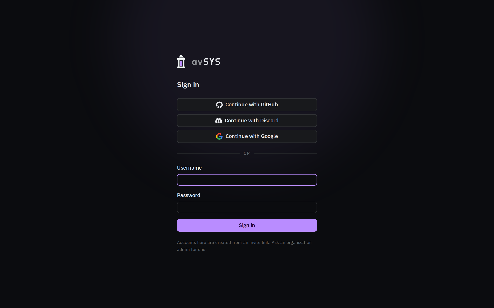
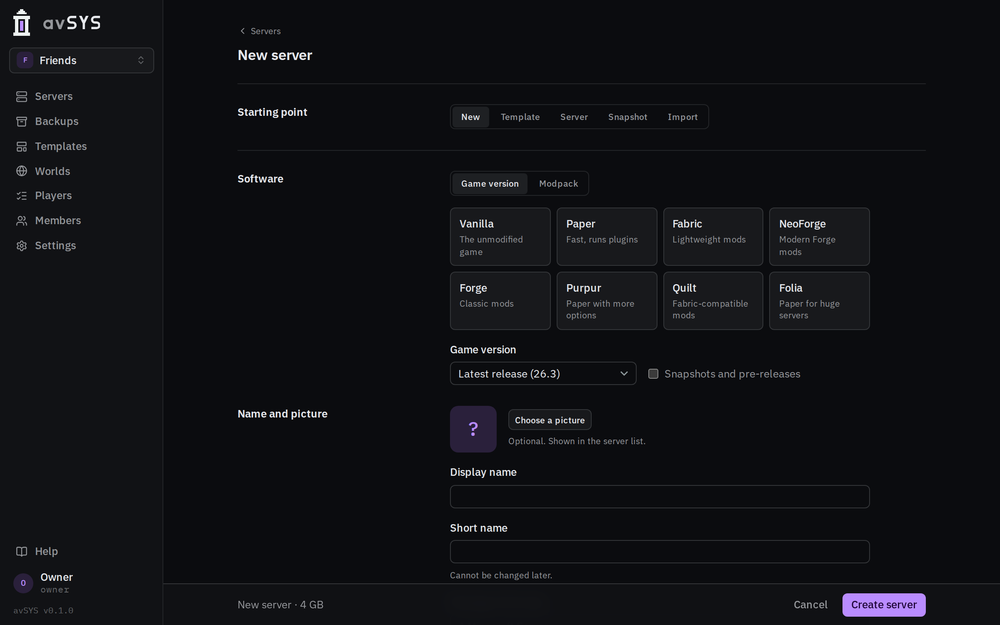
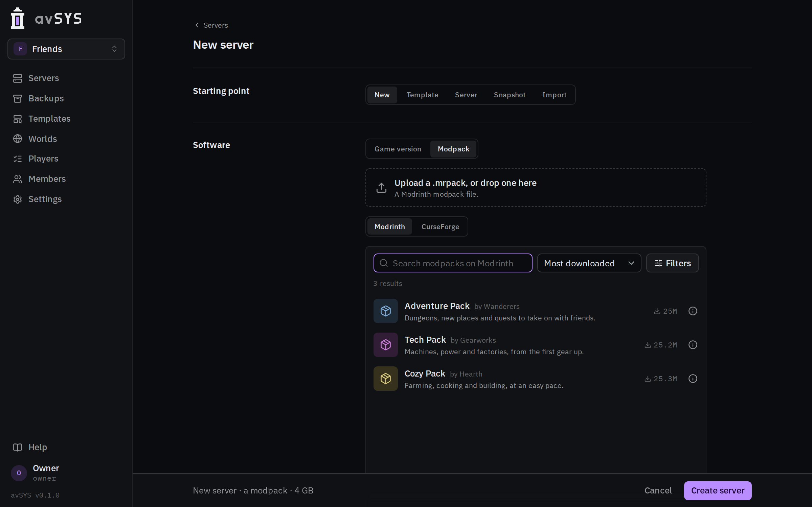
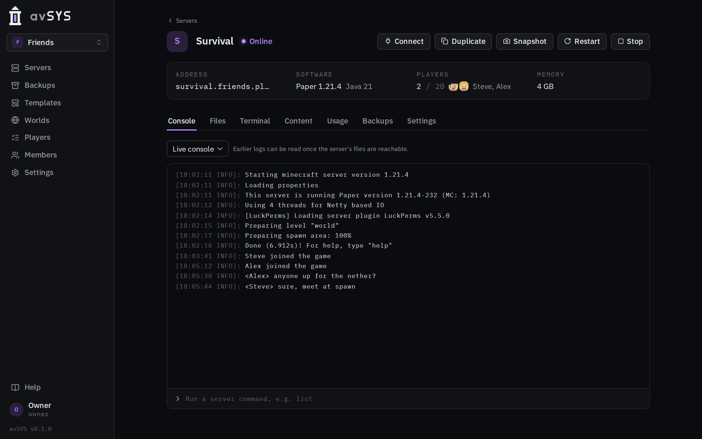
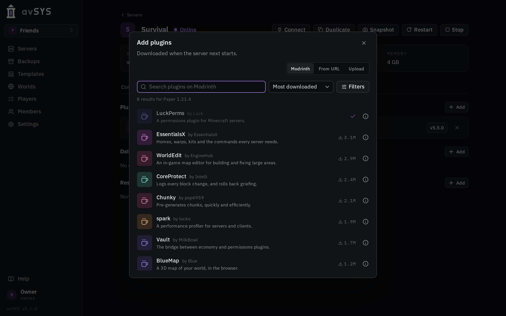
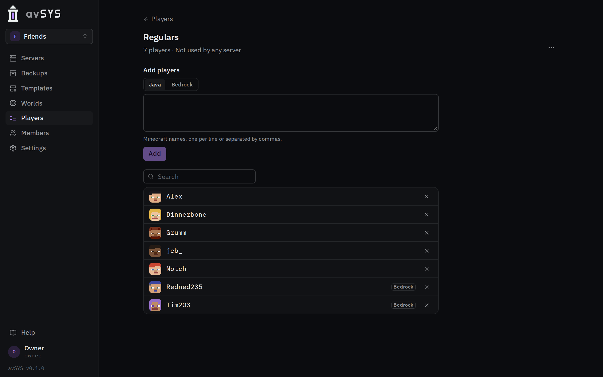
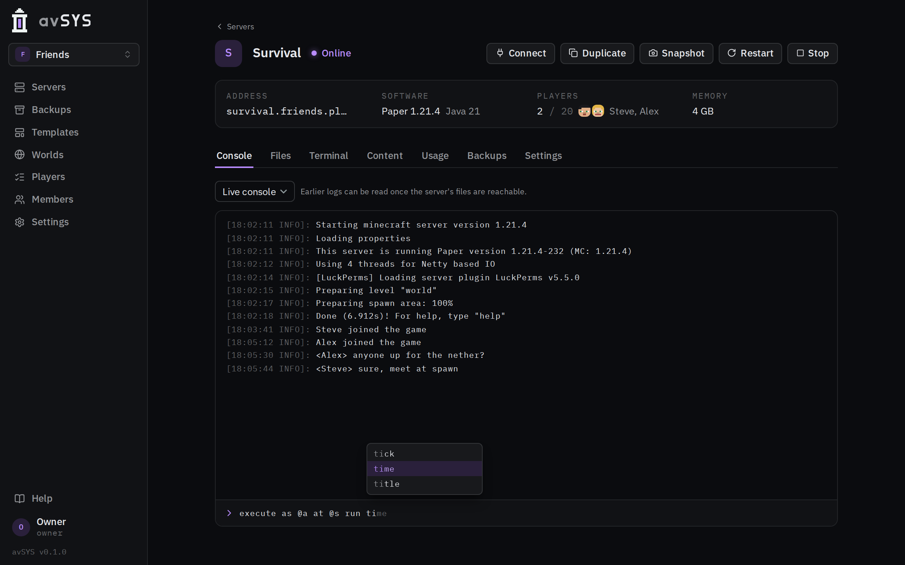
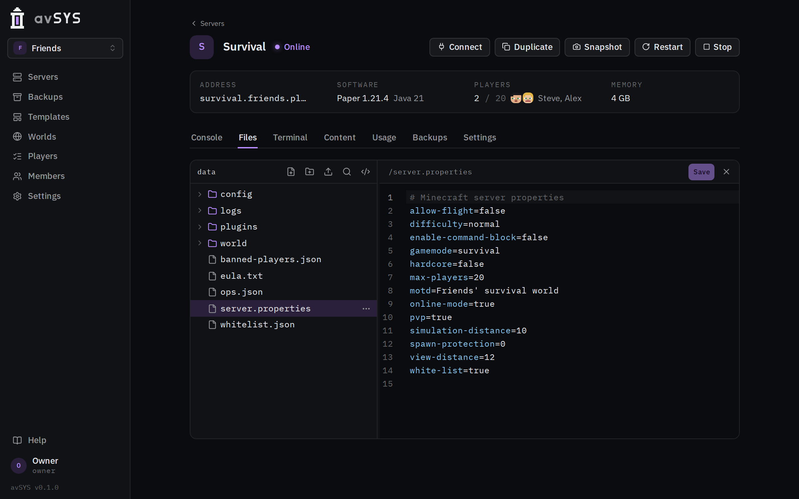
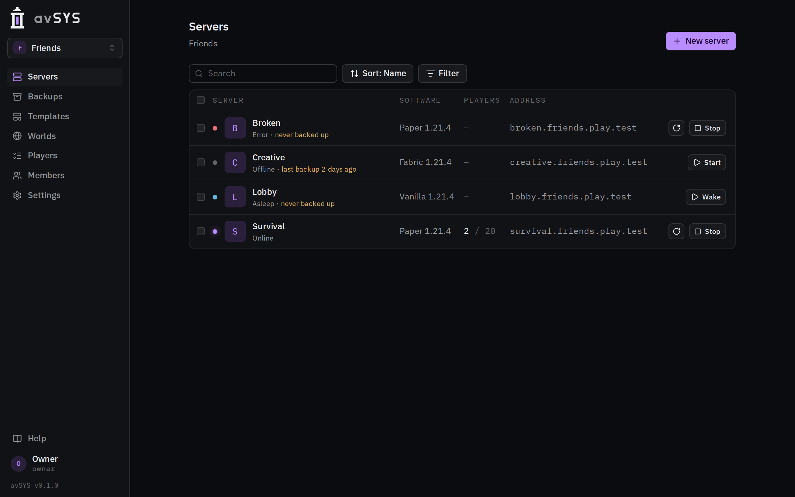
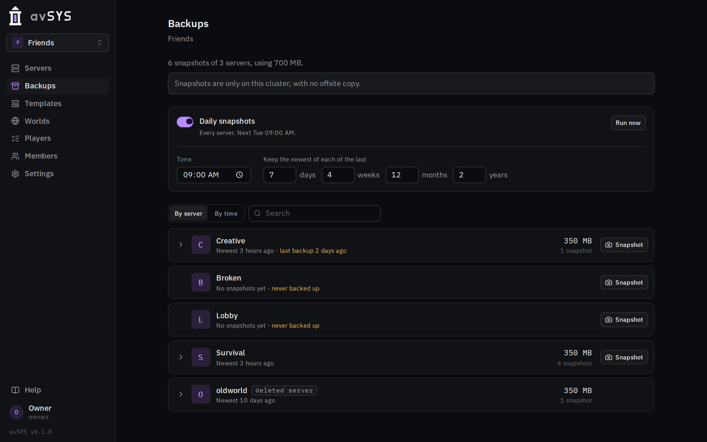

# User guide

For people who run servers and the people who play on them. Setting up
the panel itself is in [Install and operate](install.md).

- [Signing in](#signing-in)
- [Your account](#your-account)
- [Organizations and roles](#organizations-and-roles)
- [Making a server](#making-a-server)
- [The World choice](#the-world-choice)
- [A server's page](#a-servers-page)
- [Content: mods, plugins, datapacks, resource packs](#content-mods-plugins-datapacks-resource-packs)
- [Players](#players)
- [Console, files and terminal](#console-files-and-terminal)
- [SSH, SFTP and VS Code](#ssh-sftp-and-vs-code)
- [Sleeping and waking](#sleeping-and-waking)
- [Extra ports](#extra-ports)
- [Backups and snapshots](#backups-and-snapshots)
- [Templates](#templates)
- [The world library](#the-world-library)
- [Nodes and moving servers](#nodes-and-moving-servers)
- [Instance settings](#instance-settings)
- [Updating the panel](#updating-the-panel)

## Signing in

Open the panel's address and sign in with your username and password, or
with **Continue with GitHub** (or Discord, Google, or your club's own
sign-in, whichever the panel offers).



**New here?** Accounts come from invite links. Open the link an
organization admin gave you, then make an account or sign in; you join
that organization as the role the invite names. Some panels let anyone
make an account: then the sign-in page has **Create an account**.

**The very first account** on a new panel becomes its administrator. The
sign-in page says **Set up avSYS**.

**Two-factor.** Under **Account → Two-factor**, press **Set up**, enter
your password, scan the code with an authenticator app, and type the code
it shows. You get ten **recovery codes**: keep them somewhere safe. Each
works once, in place of a code from the app. After that, signing in with a
password asks for a code too. The panel's administrator can require
two-factor of administrators in **Instance settings**; then they are asked
to set it up before anything else.

**Forgot your password?** Ask the panel's administrator for a reset link.
It works once, for a day. Setting a new password with it signs you out
everywhere. If you lost your phone, the link can also turn two-factor off.

**Panels without passwords.** Some panels have passwords turned off: you
sign in only through a provider, and there is no two-factor or reset link
in the panel. Your provider's own sign-in protects your account.

## Your account

The **Account** page, from the menu at the bottom left:

- **Profile.** Your picture and display name. Your username cannot be
  changed.
- **Appearance.** **Theme**: Auto (follows your system), Light or Dark.
  **Accent**: Amethyst, Gold, Teal, Blue or Rose, or **Default** for the
  panel's. Both are also in the menu under your name, and follow you to
  other browsers.
- **Minecraft accounts.** Link the accounts you play as. Your main one is
  shown beside your name. Servers can let members in by their linked
  accounts (see [Players](#players)). A viewer's account is let in only
  once it is **verified**: press **Verify**, join the address shown in
  Minecraft as that account, and type the code the game shows you.
- **SSH keys.** For SSH, SFTP and VS Code. **Add key** to paste one, or
  **Import from GitHub** with your GitHub username.
- **API tokens.** For scripts and tools. A token acts as you. It is shown
  once, when you make it.
- **Sign-in.** Link GitHub, Discord, Google or your club's sign-in to your
  account with **Link account**, to sign in with it too. Change or set your
  password.
- **Two-factor.** See [Signing in](#signing-in).
- **Sessions.** Where you are signed in. Sign out any of them, or
  **Sign out everywhere else**. Changing your password signs out the rest.

## Organizations and roles

Servers belong to an **organization**: a club, a group of friends, a
project. Each has its own members, servers, backups, templates, worlds and
player lists. You can be in several; switch between them at the top left.
Only the panel's administrator can make organizations (**New
organization**).

### Roles

| Role | Can |
| --- | --- |
| Viewer | See servers, their status, console and snapshots |
| Operator | Also start, stop and restart servers, run commands, use files, the terminal and SSH, take snapshots, and save worlds to the library |
| Admin | Also make, change, copy and delete servers; restore and delete snapshots; make servers from them; set the backup schedule; manage templates and player lists; invite people and change their roles |
| Owner | Also make and change other owners, change the organization's name and picture, and delete it |

The panel's administrator acts as an owner in every organization they are
not a member of, and alone sees the **Nodes** and **Instance settings**
pages.

### Members

The **Members** page lists everyone, with their role and the Minecraft
names they play as.

- **Invite**: choose a role (up to your own), how long the link works and
  how many times, then **Create link** and send it.
- **Change a role** from the list. Only an owner can make someone an owner
  or change an owner. An organization always keeps at least one owner.
- **Remove** someone with the trash button; on your own row it is
  **Leave**. Their account is kept.
- The panel's administrator sees a key button on each row, to make a
  **reset sign-in** link for someone who forgot their password.

### Organization settings

Owners can change the name and picture under **Settings**. The short name
cannot be changed. **Domains** are set by the panel's administrator:
addresses under them can only be used by this organization's servers.
**Delete organization** needs its servers deleted first, and deletes its
snapshots too.

## Making a server

Every way of making a server is the same form: **New server** on the
**Servers** page. It opens filled in from where you started, and you can
change anything before you press **Create server**.



### Starting point

| Choose | To |
| --- | --- |
| **New** | Start from nothing. |
| **Template** | Make a server like a [template](#templates). |
| **Server** | Copy one of your servers as it is now, world included. |
| **Snapshot** | Make a server from any [snapshot](#backups-and-snapshots), even one of a server that was deleted. |
| **Import** | Bring in a server you ran somewhere else: a `.zip` or `.tar.gz` of its folder. The form shows what it found in it: the world, plugins, mods, operators and the whitelist. |

Other ways in, which open the same form:

- **Duplicate**, on a server's page or the server list: a copy under a
  name of its own. The original keeps running.
- **New server** on a template, a world in the library, or a snapshot.
- **Bring back** a deleted server: on the **Backups** page, press
  **New server** on one of its snapshots. Under its own name, it comes back
  with its history.

### Software

**Game version**: choose a **Server type**:

| Type | |
| --- | --- |
| Vanilla | The unmodified game |
| Paper | Fast, runs plugins |
| Fabric | Lightweight mods |
| NeoForge | Modern Forge mods |
| Forge | Classic mods |
| Purpur | Paper with more options |
| Quilt | Fabric-compatible mods |
| Folia | Paper for huge servers |

Then the **Game version**. Only versions that type has a build for are
listed. **Latest release** is settled to its version number when the
server is made, so it never upgrades by itself. Tick **Snapshots and
pre-releases** to see test versions; a world opened in one may not open in
older versions. Fabric, Quilt, Forge and NeoForge also have a **Loader
build**, newest unless you choose.

**Modpack**: search Modrinth or CurseForge and pick one. Or upload a
**.mrpack** file. The pack decides the game version and loader.



### The rest of the form

- **Name and picture.** The display name, the short name (used in
  addresses and SSH; it cannot be changed later), a picture for the server
  list, and the message of the day.
- **Content.** Mods, plugins, datapacks and resource packs to start with.
  See [Content](#content-mods-plugins-datapacks-resource-packs).
- **World.** See [The World choice](#the-world-choice).
- **Players.** Who can join, and who is an operator. See
  [Players](#players).
- **Resources.** **Memory** and **Storage**. Storage can grow later, not
  shrink. **Node** picks where it runs, automatic unless you choose. Under
  **Launch flags**, Aikar's flags are on by default.
- **Network.** The **Hostname** players type. Under **Connection, ports
  and sleep**: how it is reached (the shared address is usual), **Sleep
  when empty**, and **Extra ports**.
- **Backups.** Follow the organization's snapshot schedule, set its own,
  or none.
- **Minecraft EULA.** Tick the box to accept it.

Copies also have **Start when ready**.

If something is missing or wrong, the form says so under the field and
takes you there.

### After Create

The panel goes to the new server's page. If there are files to send from
your computer (an archive, a world, uploaded mods, a picture), a card in
the corner shows how far along they are. Keep the tab open until it is
done: closing it stops them, and the browser asks first. The card says
what went wrong if something did, with a link to where to put it right.
Once everything is in, the server starts.

Copies of a server, a template or a snapshot are made by the panel itself:
you can leave the page. The server says how far along it is, and cannot be
started or changed until its files are all in.

## The World choice

The **World** section of the form decides which world the server starts
with:

| Choose | For |
| --- | --- |
| **Keep world** | Copies and imports: the world that came with them. |
| **New world** | A world the game makes when it first starts. Set **Game mode**, **Difficulty**, and under **World options and more** the **World type**, **Seed**, **Generate structures** and **Hardcore**. |
| **Library world** | A world from the organization's [world library](#the-world-library). |
| **Upload world** | A `.zip` or `.tar.gz` of a world folder, the one with `level.dat`. A single-player save works. |

Modpack servers have the same choices. A world last opened in a newer game
version than the server's may not load; the form asks before it goes on.

World type, seed, structures and hardcore are fixed once the world exists.
To swap the world of a server later, use **Settings → World → Replace the
world** while it is stopped. A snapshot is taken first.

**Settings → World** also shows what the world is now:

- Where it came from: *Drehmal · from the world library* (with the world's
  picture and a link to it while the library still has it), *Uploaded ·
  my-save.zip*, *Imported · server.zip*, *New world · seed 1234*, *Copied
  from Survival*, *From a snapshot of Survival* or *From the template
  Event*, and when it was put in. A copy, a server made from a snapshot or
  a template, and a restore keep where the world first came from. Servers
  made before the panel kept this show none.
- What the world says of itself, read from its files: its name, seed, the
  game version it was last opened in, when it was last played, and its
  size. Nothing while its files cannot be reached.

Its buttons:

- **Download** saves the world as it is now to your computer, as a `.zip`
  of a single-player save: unzip it into Minecraft's `saves` folder to play
  it. It works while the server runs: the game saves everything first and
  holds its saves until the download ends, then saves again. A Nether and
  End that Paper keeps beside the world go in it, where single-player has
  them. It is off while the server's files cannot be reached, before the
  game has made a world, and while the server starts or stops.
- **Replace the world** (above).
- **Put back** puts the library world back, as it is in the library, for a
  server whose world came from there: the same as **Replace the world**
  with that world picked, a snapshot taken first. Use it to reset a map
  between event rounds.
- **Delete the world** removes the world, its Nether and End included, after
  asking. A snapshot is taken first, so it can be put back from
  **Backups**. The server's settings stay as they are: the next start makes
  a new world from them, with the seed, world type and the rest set there.

Replacing, putting back and deleting the world need the server stopped.

## A server's page



At the top: the server's picture, name and status, who else has the page
open, and what was done to it last (press it for the **Activity** list).
The buttons:

- **Connect**: the address to add in Minecraft (**Multiplayer → Add
  Server**), the Bedrock address if it has Geyser, and the SSH command.
- **Duplicate**, **Snapshot**, and **Start**, **Restart** or **Stop**
  (**Wake** while asleep).

Below: the address, software and Java, players, and memory and node.
**Restart to apply pending changes** shows when settings were changed while
it ran.

The tabs:

| Tab | Who | What |
| --- | --- | --- |
| Console | Everyone | The live log, earlier logs and crash reports; operators can type commands |
| Files | Operators | Browse, edit, upload and download the server's files |
| Terminal | Operators | A shell on the server |
| Content | Everyone; admins change it | Modpack, mods, plugins, datapacks, resource packs |
| Usage | Everyone | Memory, CPU, ticks per second, time per tick, players |
| Backups | Everyone | Snapshots, restore, schedule, save world, save as template |
| Settings | Admins | Everything else |

Most settings apply at the next restart. **Settings** has: **General**
(picture, name, message of the day), **Software** (type, version, loader
build), **Gameplay**, **Players**, **Resources**, **Node**, **Network**,
**Sleep**, **Advanced** (the image's environment and image), **World**, and
**Delete server**.

**Changing the game version.** Under **Settings → Software**. Going to an
older version asks first, since a world opened in a newer game may not
load. Content is matched to the new version. A modpack server changes its
pack's version under **Content** instead.

**Deleting a server.** **Settings → Delete server**. Type its name to
confirm. A last snapshot is taken first, so it can be brought back; you can
switch that off. Its snapshots stay on the **Backups** page until someone
deletes them.

**Pictures.** A server's picture is the icon players see in their server
list. Upload any picture and it is cropped square; players see a new one
after the next restart. Organizations and people have pictures too. Phone
photos come out the right way up.

## Content: mods, plugins, datapacks, resource packs

The **Content** tab shows what is installed. Admins change it.

**Add** opens a picker with:



- **Modrinth** and **CurseForge**: search, filter by category, sort, and
  look closer at a project. Results fit the server's type and game version.
  CurseForge needs a key the administrator adds in
  [Instance settings](#instance-settings); until then its tab says so.
- **From URL**: a direct link to the file.
- **Upload**: `.jar` files (or `.zip` for datapacks) from your computer.

What a server can take depends on its type: mods for Fabric, Quilt, Forge
and NeoForge; plugins for Paper, Purpur and Folia; datapacks for all.

- **Each item stays on one version** until you change it, with its version
  button. **Update to the best fit** picks the newest that fits.
- The panel picks a version that runs on the server's Java. If something
  needs a newer Java, the server is moved to it, and the page says so.
- If a project has no build for the server, adding it says so, instead of
  a broken start.
- Added content is installed at the next start. Removing an item takes it
  off at the next start.
- Some CurseForge authors allow downloads only on CurseForge. Those are
  marked: download the file there, then add it with **Upload**.

**Modpacks.** A modpack server shows its pack, with its version button, and
the mods in it (**Mods in this pack**). Files only players need are marked
"Client only, left out". **Mods added on top of the pack** are your own.
For an uploaded `.mrpack`, **Upload newer** replaces it; each start puts
the pack's own files back, configs too. Some CurseForge packs list files
that can only be downloaded on CurseForge: the page says which, and they go
in a folder named `downloads` on the **Files** page.

**Resource packs.** **Add resource pack** from Modrinth, CurseForge, a URL
or a `.zip`. Several are joined into one pack, in the order shown: where
two change the same thing, the higher one wins. **Required** makes players
accept it to join; **Prompt** is the message they see. A modpack's own
resource pack can be used with one press.

## Players

Under **Settings → Players** (and **Players** on the new server form).

**Who can join.** A server made in the panel is for its organization by
default: the whitelist is on, and **Every member** who has linked a
Minecraft account is on it. Choose **Operators and above**, **Admins and
above**, **Owners**, **Only the whitelist**, or **Anyone with the address**
for no whitelist.

**Operators by role.** Members from the operator role up are made
operators in game, unless you choose otherwise.

Both keep up by themselves: when the server starts, and within seconds of
someone linking an account, joining, leaving, or changing role.

- **Members** lists every member: whitelisted or operator by role, picked
  by you, or left out. Untick a member to keep them off.
- **Whitelisted players** and **Operators**: players who are not members,
  one name or UUID per line. These stay.
- **Saved lists**: tick lists from the **Players** page to use them on this
  server. See below.
- **Added in game**: players someone added with `/whitelist add` or `/op`.
  **Keep** lists them in the settings; **Remove** takes them off.
- Someone taken off the whitelist is put out, not only kept out.
- A member taken off in game with `/whitelist remove` or `/deop` is put
  back within a minute. To keep a member off, untick them under
  **Members**.
- **Account check** off lets in accounts Mojang has not checked. Leave it
  on unless you know you need it.

### Saved player lists

The **Players** page in the sidebar keeps lists of players to use on any
number of servers, as their whitelist or operators: a group of friends, a
team, staff. **New list**, give it a name, and add players: **Java** by
Minecraft name, **Bedrock** by Xbox gamertag. A list shows which servers use
it. Changing a list changes every server using it. **Save as list** under a
server's whitelist or operators makes one from what it has.



### Bedrock players

Bedrock players (phones, consoles, Windows) join a Java server through
**Geyser** and **Floodgate**. Add both on the **Content** tab, and open
Geyser's port under **Extra ports** (it is a quick pick). The **Connect**
button then shows the Bedrock address. Put Bedrock players on saved lists
by gamertag. Until Geyser and Floodgate are added, the settings say Bedrock
players cannot join.

## Console, files and terminal

**Console.** The live log of the server. Operators type commands in the
box at the bottom (no `/` needed); up and down bring back earlier ones.
As you type, the commands and subcommands that fit are listed above the
box, with the argument that comes next: up and down pick one, **Tab** or a
click puts it in, and Ctrl/Cmd-Z takes it out again. The list has the
game's own commands for the server's version, ready a minute or so after a
version's first start, and those of its mods and plugins, from the
server's own help while it runs: their names and options, with each
argument by its name only, not what it takes.


The **Log** menu opens earlier runs and crash reports, with search,
**First error**, and **Download**.

**Files.** Operators browse the server's folder: **New file**, **New
folder**, **Upload** (or drag files in), **Find a file**, and on each row
**Download**, **Extract here** (for archives), **Rename**, **Move to…**,
**Delete**. Select several to download them as a `.zip`, move or delete
them. Text files up to 2 MB open in the editor; **Save** or Ctrl/Cmd-S.
If someone else changed the file since you opened it, saving says so
instead of overwriting their change. Pictures open as pictures.



**Terminal.** A shell on the server, in the server's folder, as in SSH.

On the server, the `mc` command talks to the game:

```console
$ mc console     # the console: its log, and a line to type on
$ mc run list    # one command, with its answer
There are 3 of a max of 20 players online: ...
$ mc logs        # follow the log
$ mc restart     # restart the game, keeping this shell
```

The files, terminal and SSH keep working while the game is stopped, so a
server that will not start can still be fixed.

## SSH, SFTP and VS Code

Add an SSH key under **Account → SSH keys**, then use the command under
**Connect** on the server's page:

```sh
ssh creative.friends@panel.example.com -p 2222
```

`creative` is the server's short name, `friends` the organization's. You
land in the server's folder. Operators and above can connect. scp, sftp
and rsync work the same way. To copy a world in, stop the server and:

```sh
rsync -av -e 'ssh -p 2222' ./world/ creative.friends@panel.example.com:world/
```

When your connection ends, what you ran over it is stopped, as it is when
a terminal closes. For something that should keep going, start it in
`tmux` and detach.

**Open in VS Code** (under **Connect**, or on the **Files** tab) opens the
server in VS Code with Remote SSH.

## Sleeping and waking

A server can sleep while nobody plays: **Settings → Sleep → Sleep when
empty**, after a number of minutes with no players (15 unless you change
it). It needs the shared address.

While asleep it holds no memory, and shows **Asleep** in the server list in
Minecraft. Joining it wakes it: the first join is told it is waking up, and
a minute later you can join. Operators and up can also press **Wake** on
the server's page.



## Extra ports

Some mods and plugins listen on ports of their own: voice chat, Geyser
for Bedrock players, a web map. Open them under **Settings → Network →
Extra ports** (or on the form). There are quick picks for Geyser, Simple
Voice Chat, Plasmo Voice, BlueMap and Dynmap, and the panel offers to open
the port of a known mod you installed, setting the mod up to match. A
server can have up to eight.

Each shows where players reach it: usually the game's own address with a
port of its own, which the settings show. A map port adds **Open BlueMap** (or Dynmap) beside the address.

A sleeping server wakes when someone reaches one of its extra ports too,
such as a voice chat client connecting or someone opening the map.

## Backups and snapshots

A **snapshot** is a server's files and settings at one moment. Taking one
does not stop the server. Snapshots of an organization's servers share
storage, so each costs only what changed.



**Taking one.** **Snapshot** on the server's page (operators and up).

**Every day.** Each server is snapshotted once a day without anyone asking,
at the time on the organization's **Backups** page. A server that has not
changed since its last snapshot gets no new one. Of these daily snapshots,
the newest of each of the last 7 days, 4 weeks, 12 months and 2 years are
kept; admins can change that, or switch daily snapshots off. Days with no
change do not count, so a server that stops changing keeps its history.
A server can have its own schedule, on its **Backups** tab: off, or its
own time and how many to keep.

**What is never removed for you.** Snapshots taken by hand, the ones taken
before a restore or a delete, and every snapshot of a deleted server stay
until someone deletes them.

**Restore.** On a server's **Backups** tab, an admin's **Restore** on a snapshot puts
the server back to it: its world, settings, game version and mods. The
server stops while its files are put back, then starts again. A snapshot
is taken first, so you can undo it. Memory, storage, address and sleep are
left as they are.

**A new server from a snapshot.** **New server** on any snapshot. Under the
name of a server that was deleted, it brings that server back. Otherwise it
is a copy, and the original is not touched.

**The Backups page** lists every snapshot of the organization's servers,
deleted ones included, by server or by time, with search and filters. A
failed or missing snapshot shows on the server list.

**Offsite copy.** Where the panel has a second place to keep snapshots,
the **Backups** page says whether the copy is up to date. If this cluster's
copy is lost, the panel's administrator can bring them all back from
there.

## Templates

A **template** is a server kept to make others like it: a lobby, a
minigame, a modded setup. The **Templates** page.

- **New template** starts from nothing (settings only: the world is made
  when a server first starts), from a server, from a snapshot, or from
  another template.
- **Save as template** on a server's **Backups** tab saves it as it is now,
  as a new template or a new version of one.
- A template keeps **Versions**. New servers get the newest, unless you
  choose one with **Use**.
- A template can give its servers a world of its own, from the library or
  uploaded, or a new world each time.
- **New server** on a template opens the form filled in from it.

## The world library

The **Worlds** page keeps maps to start servers from.

- **Add world**: upload a `.zip` or `.tar.gz` of a world or a save, or save
  one from a server or a snapshot (operators and up). **Save world** on a
  server's **Backups** tab does the same. The nether and the end come
  along, and so does the server's resource pack.
- A world can carry a resource pack, with **Required** and **Prompt**.
- **New server** on a world opens the form with it chosen. **Download**
  gives it back as a single-player save.

A world in the library is kept unpacked, as its own files, with the
organization's snapshots. An uploaded archive is unpacked on the panel
when it is added; its size in the list is the world's own. A server made
from a library world, its snapshots, **Replace the world** and **Put back**
all share those files with the library, so a 4 GB map stored once does not
take another 4 GB with each server and snapshot that has it.

Worlds added before the library kept them unpacked are unpacked once,
under the same name and link, after the panel is updated. Each shows
*Unpacking* in the list meanwhile and can be used as before. If one cannot
be unpacked, for example when the panel's disk is too full, it says *Could
not unpack* with the reason, still works as before, and is tried again the
next time the panel starts.

## Nodes and moving servers

A new server goes to the fastest node with room, unless you pick one on the
form. Its page says which.

**Moving a server.** **Settings → Node → Move to**, choose a node, and
**Move**. The server stops for a while: its files are snapshotted and put
back on the new node, and it starts again if it was running. If its node is
down, **Move from snapshot** rebuilds it on another node from its newest
snapshot.

**The Nodes page** is for the panel's administrator: each node's speed,
memory, servers and players.

- **Measure speed** measures every node, to decide which is fastest.
- **New servers on \<node\>**, when off, keeps new servers off that node
  unless someone picks it.

## Instance settings

Settings for the whole panel, for its administrator: **Account menu →
Instance settings**, under **Nodes**.

- **Updates**: a newer avSYS, what is new and an **Update** button, and
  **Install fixes by itself**. See [Updating the panel](#updating-the-panel).
- **Sign-in**: **Require two-factor for administrators** (when passwords
  are on), and how people sign in and make accounts. Those are set when
  avSYS is installed; see [Install and operate](install.md#sign-in-providers).
- **CurseForge**: the API key that lets people add content and modpacks
  from CurseForge. It is never shown again once saved; **Replace** or
  **Remove** it.
- **Accent**: the accent for everyone who has not picked their own (see
  [Your account](#your-account)). Amethyst unless you change it.

## Updating the panel

When a newer avSYS is out, **Instance settings** says so to the
administrator, with what is new and an **Update** button (the **Nodes**
page points there). The panel restarts on the new
version: players are disconnected for a moment, and servers keep running.
Everyone's page offers to reload once it is back.

**Install fixes by itself** has the panel install small fix releases on its
own, at a moment when nobody is playing. Bigger releases wait for the
button.
